<div align="center">
  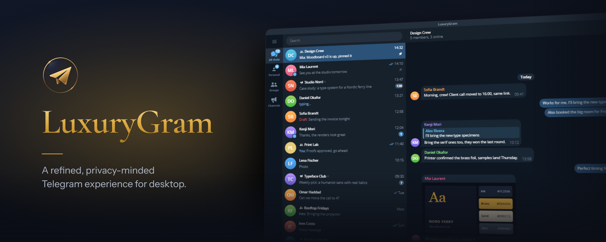

  <h1>LuxuryGram</h1>
  <p><strong>Telegram Desktop with more control: privacy on your terms, a record of every edit and deletion, and safe plugins.</strong></p>
  <p>Open source · Built from AyuGram · Based on Telegram Desktop · Windows and Linux</p>

  <p>
    
    
    
  </p>

  <p>
    <a href="https://github.com/GofMan5/LuxuryGram/releases"></a>
  </p>

  <p>
    <a href="#features">Features</a> ·
    <a href="#plugins">Plugins</a> ·
    <a href="#faq">FAQ</a> ·
    <a href="#install">Install</a> ·
    <a href="#build-from-source">Build</a> ·
    <a href="SECURITY.md">Security</a>
  </p>

  <p>
    <a href="README.md"><strong>English</strong></a> · <a href="README-RU.md">Русский</a>
  </p>
</div>

> [!IMPORTANT]
> Download LuxuryGram only from this repository's [Releases](https://github.com/GofMan5/LuxuryGram/releases) page and check the file against the published `SHA256SUMS.txt` before the first run.

> [!NOTE]
> LuxuryGram is an independent, unofficial client. It is not affiliated with, maintained by, or endorsed by Telegram.

## Take the tour

<div align="center">
  <a href=".github/assets/showcase/luxurygram-tour.mp4?raw=true">
    
  </a>
  <br>
  <sub>Click the preview to open the full tour video (MP4, 1080p, 17 MB).</sub>
</div>

## Why LuxuryGram

<table>
  <tr>
    <td width="50%" valign="top">
      <h3>Privacy on your terms</h3>
      Read chats and stories without read receipts, type without the typing indicator, and come online only when you choose. Streamer Mode hides the window from screen capture on Windows and macOS.
    </td>
    <td width="50%" valign="top">
      <h3>Nothing quietly disappears</h3>
      Deleted messages stay readable on your device, edits keep every earlier version, and Watcher shows when a contact was actually online.
    </td>
  </tr>
  <tr>
    <td width="50%" valign="top">
      <h3>Extend it safely</h3>
      Install JavaScript plugins from a GitHub link. Each one runs in its own sandbox and gets only the permissions you approve.
    </td>
    <td width="50%" valign="top">
      <h3>Trust you can check</h3>
      Open source, released only through this repository with SHA-256 checksums, and self-updates that refuse any package whose signature does not verify.
    </td>
  </tr>
</table>

## Features

<table>
  <tr>
    <td colspan="2" valign="top">
      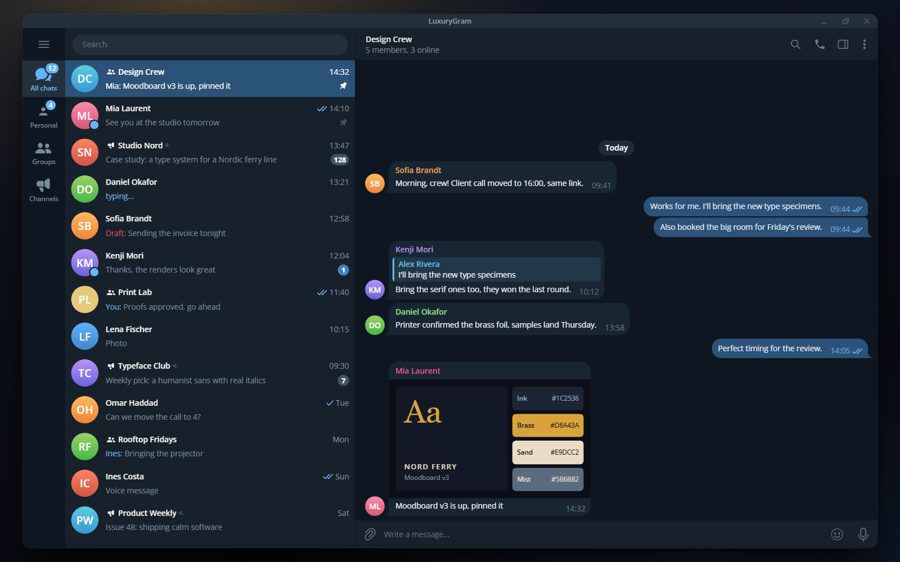
      <p><strong>Telegram, refined for desktop</strong><br>
      Your chats, folders and groups in the familiar Telegram Desktop layout, with LuxuryGram's controls built in.</p>
    </td>
  </tr>
  <tr>
    <td colspan="2" valign="top">
      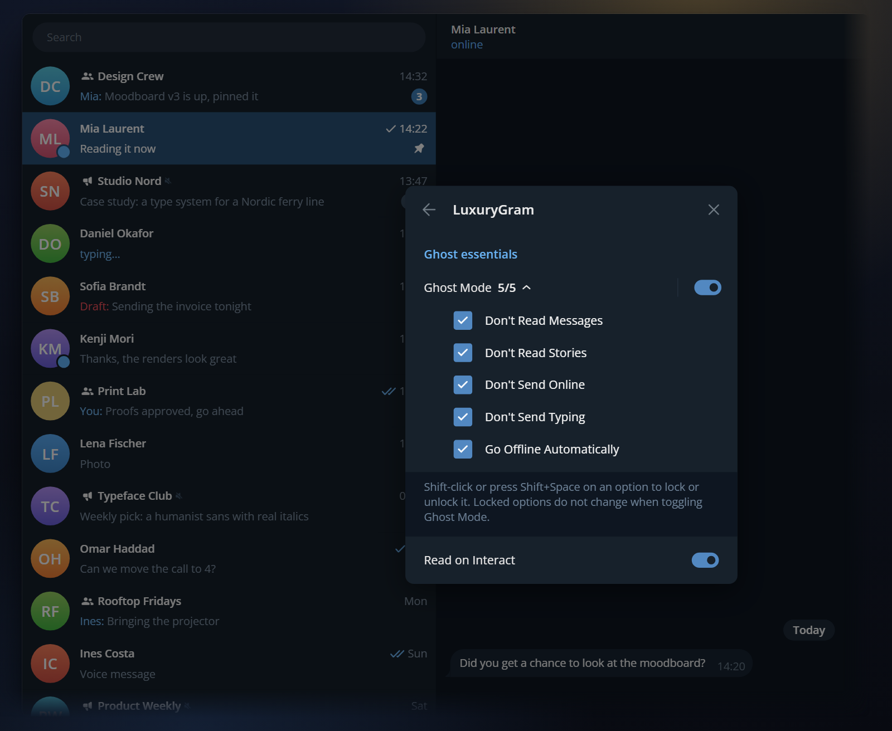
      <p><strong>Ghost Mode, your rules</strong><br>
      Read chats and stories, type and come online on your own terms, with each Ghost switch one click away.</p>
    </td>
  </tr>
  <tr>
    <td colspan="2" valign="top">
      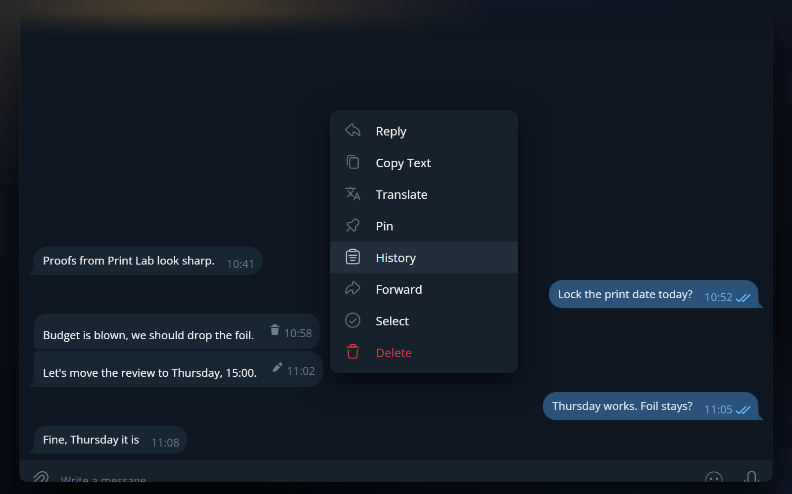
      <p><strong>Nothing quietly disappears</strong><br>
      Deleted messages stay readable with a trash mark, edited ones get a pencil, and right-click › History shows every earlier version.</p>
    </td>
  </tr>
  <tr>
    <td width="50%" valign="top">
      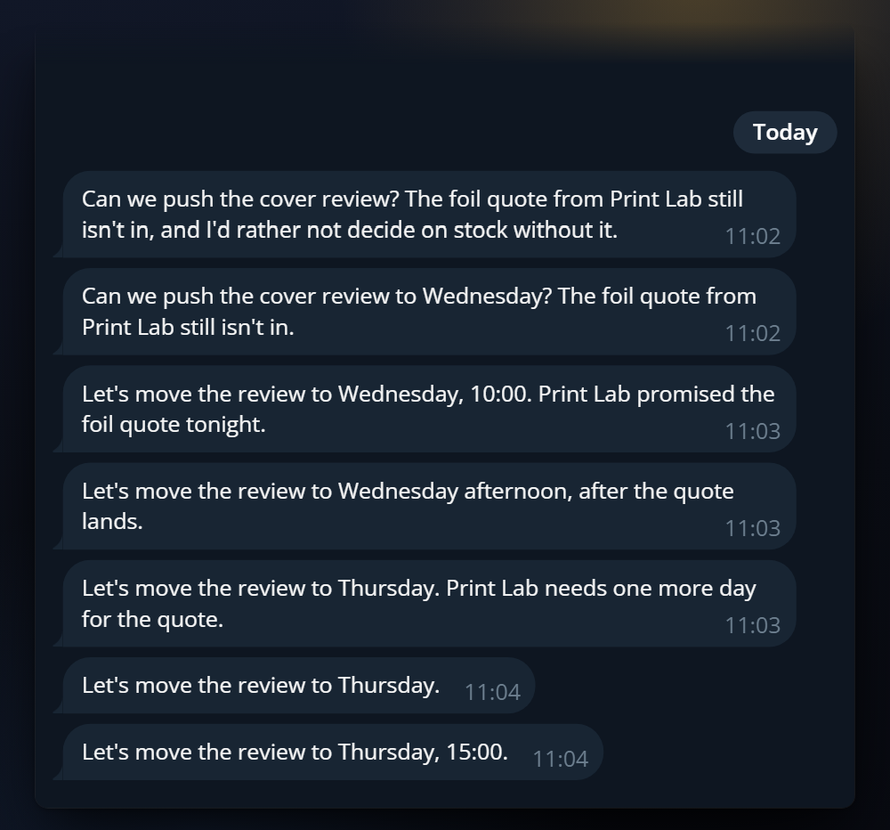
      <p><strong>Every edit, on record</strong><br>
      The History view lists each saved revision of a message with the time it was captured.</p>
    </td>
    <td width="50%" valign="top">
      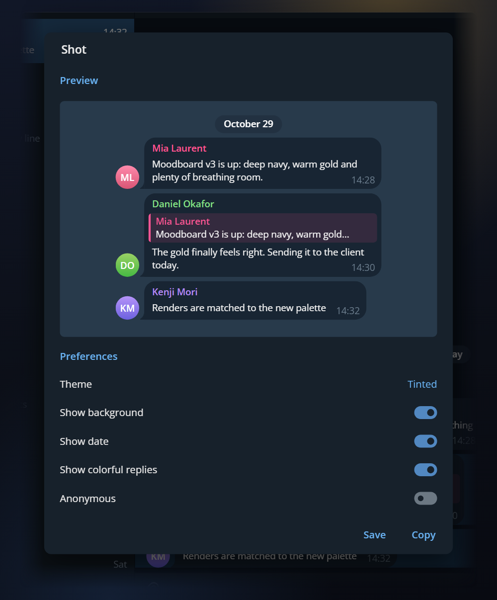
      <p><strong>Messages into polished images</strong><br>
      Turn selected messages into a clean, themed image you can save or copy, with optional anonymity.</p>
    </td>
  </tr>
  <tr>
    <td colspan="2" valign="top">
      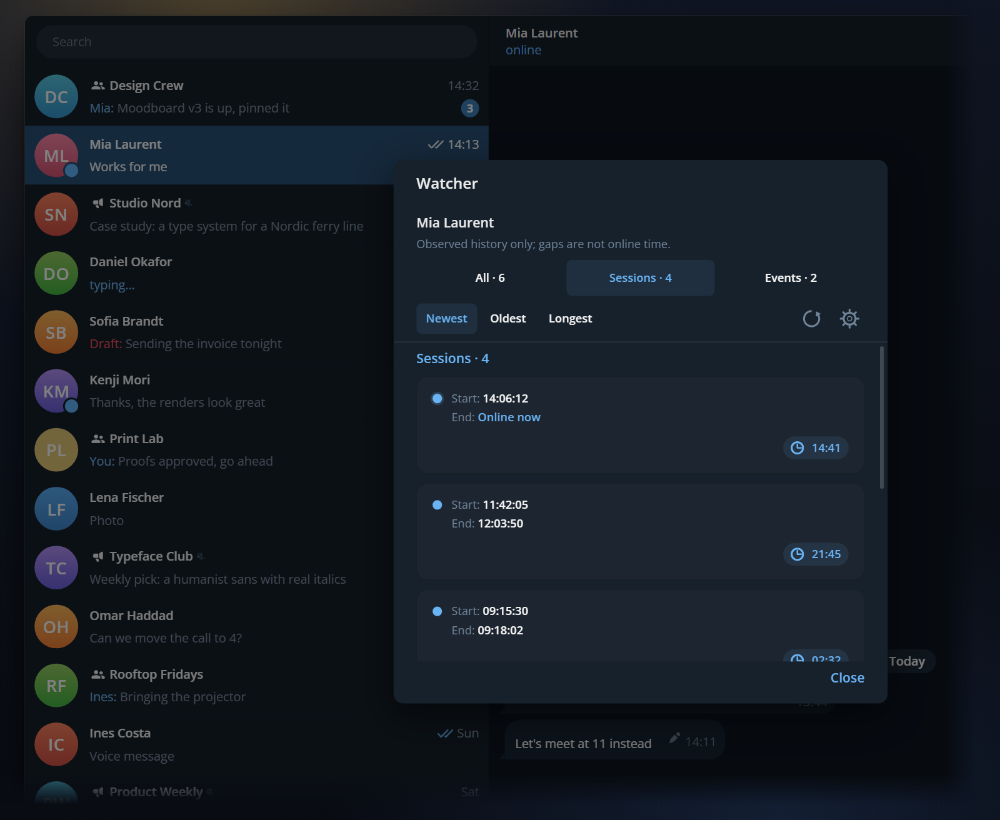
      <p><strong>See who's online, when</strong><br>
      Watcher logs each contact's online sessions with durations and keeps edited and deleted messages. Online session logging is off until you turn it on.</p>
    </td>
  </tr>
  <tr>
    <td colspan="2" valign="top">
      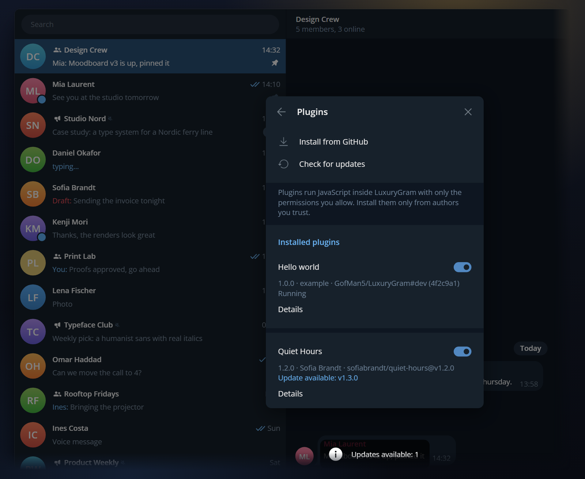
      <p><strong>Plugins, straight from GitHub</strong><br>
      Install JavaScript plugins from any GitHub repository, switch them on or off, and get update notices in one place.</p>
    </td>
  </tr>
  <tr>
    <td colspan="2" valign="top">
      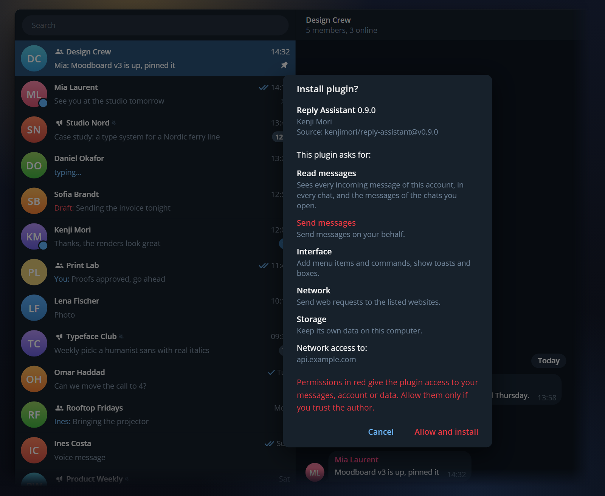
      <p><strong>You approve every permission</strong><br>
      Before a plugin installs, LuxuryGram lists each permission it requests and marks the dangerous ones in red.</p>
    </td>
  </tr>
  <tr>
    <td colspan="2" valign="top">
      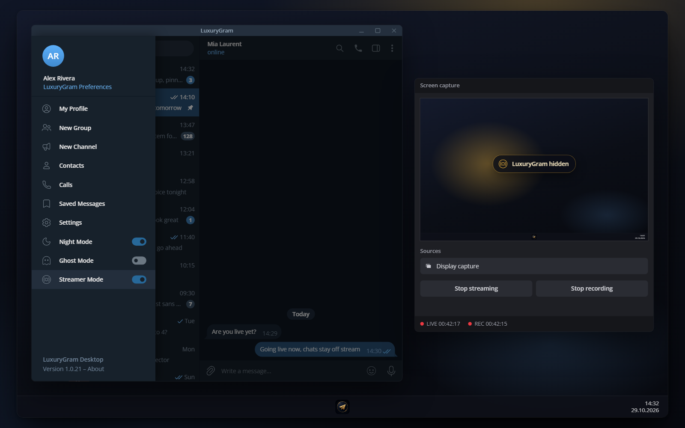
      <p><strong>Invisible to screen capture</strong><br>
      With Streamer Mode on, the LuxuryGram window disappears from screen capture while you still see it on your desktop (Windows and macOS).</p>
    </td>
  </tr>
  <tr>
    <td colspan="2" valign="top">
      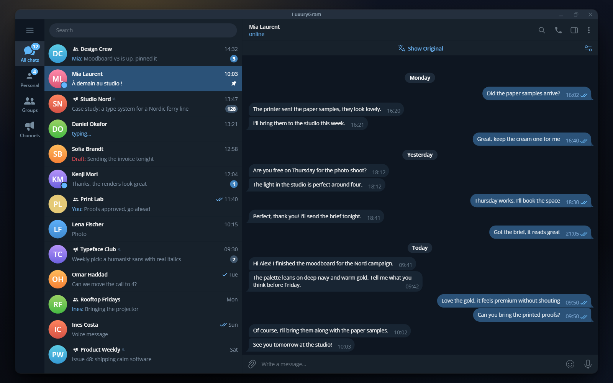
      <p><strong>Translate with your choice of provider</strong><br>
      Read messages in other languages in place, translated by the provider you pick: Telegram, Google or Yandex, plus the system translator on macOS and on Linux with Crow Translate installed.</p>
    </td>
  </tr>
  <tr>
    <td width="50%" valign="top">
      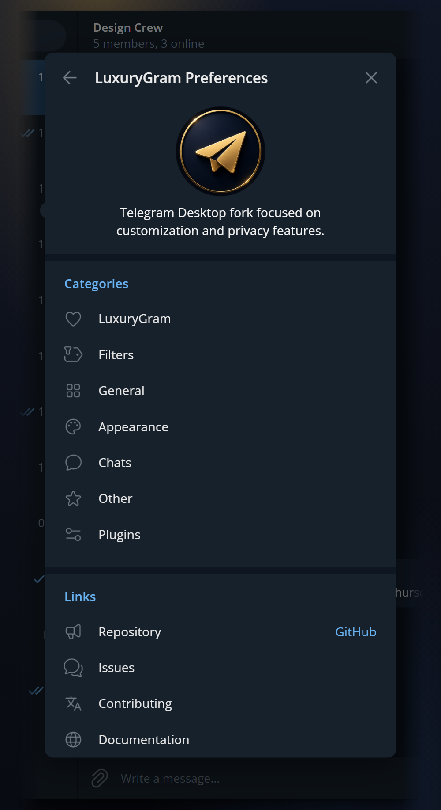
      <p><strong>Everything in one place</strong><br>
      LuxuryGram Preferences groups every customization and privacy setting into clear sections.</p>
    </td>
    <td width="50%" valign="top">
      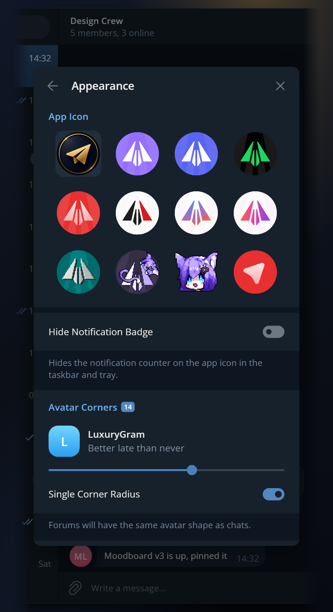
      <p><strong>Make it look yours</strong><br>
      Pick from 12 app icons, shape your avatars and, on Windows and macOS, hide the taskbar badge right from Appearance.</p>
    </td>
  </tr>
</table>

<sub>Screens are interface illustrations with fictional people and chats.</sub>

### Also inside

- **Filters and Shadow Ban.** Hide spam and unwanted senders with regex filters, shadow-ban people without blocking them, and share filter sets through import and export.
- **Power-user message menu.** Details (hold Shift or Ctrl) and Repeat Message in the right-click menu, both set under **Settings › LuxuryGram Preferences › Chats › Context Menu Elements**, and forward without the sender or caption, or straight to Saved Messages.
- **Expanded music player.** Cover art, seekable progress and controls, with a button to save the cover.
- **Cleaner Telegram.** Turn off stories, ads, similar-channel suggestions and link warnings, lift selection and sticker limits, and filter Zalgo text.
- **Processor-aware performance.** Background work sizes itself to your CPU, keeps a core free for the interface, and decodes first video frames, cached custom emoji and animated sticker files off the interface thread.

Everything is under **Settings › LuxuryGram Preferences**, also reachable from the side menu. Some features work only on your device and cannot change how Telegram's servers behave.

## Plugins

Plugins are GitHub repositories with a `plugin.json` and JavaScript modules. LuxuryGram downloads the listed files, shows you every permission they ask for, and runs the code in a QuickJS sandbox with no file or process access. Methods that touch login, sessions or passwords, or spend Stars or money, are never available to a plugin, and neither are the login-code service chat or your phone number. Plugins are available from LuxuryGram 1.0.22.

A complete plugin that adds a `/hello` command needs one permission:

```json
{
  "id": "com.yourname.hello",
  "name": "Hello",
  "version": "1.0.0",
  "api": 1,
  "runtime": "js",
  "main": "main.js",
  "permissions": ["ui"]
}
```

```js
lux.ui.addCommand({
  name: 'hello',
  description: 'Say hello',
  handler: ({ peer, args }) => lux.ui.toast(`Hello, ${args.trim() || peer.title}!`),
});
```

Push it to GitHub, then open **Settings › LuxuryGram Preferences › Plugins › Install from GitHub** and paste `yourname/repo`. Start with the [author guide](docs/plugins/AUTHORING.md), the [`lux.d.ts`](docs/plugins/lux.d.ts) typings and the [hello-world example](docs/plugins/examples/hello-world/); the [architecture notes](docs/plugins/ARCHITECTURE.md) give the full contract.

## FAQ

<details>
<summary><strong>Is LuxuryGram safe to install?</strong></summary>
<br>
The source is public, and official builds are published only on this repository's <a href="https://github.com/GofMan5/LuxuryGram/releases">Releases</a> page, each with a <code>SHA256SUMS.txt</code> you can check before running anything. The archives are not code-signed, so Windows SmartScreen may warn on first launch. If your threat model needs independent verification, review the code and <a href="#build-from-source">build it yourself</a>.
</details>

<details>
<summary><strong>Can using LuxuryGram get my account restricted?</strong></summary>
<br>
Possibly, as with any third-party client. LuxuryGram talks to Telegram through the same public API other clients use, and Telegram can restrict any account at its own discretion. No unofficial client can promise otherwise. Features such as Ghost Mode only change what your own client sends or shows; use them knowing that.
</details>

<details>
<summary><strong>How do updates work?</strong></summary>
<br>
The app checks this repository for a newer release, downloads it and verifies its signature with the LuxuryGram key before unpacking anything. A package that fails the check is refused. You can turn this off under <strong>Settings › Advanced › Update automatically</strong>. The AUR package updates through pacman instead.
</details>

<details>
<summary><strong>Is there a macOS version?</strong></summary>
<br>
Not as a published package yet. Windows x64 and Linux x64 archives are published; macOS has a <a href="docs/building-mac.md">build guide</a>.
</details>

<details>
<summary><strong>Do saved deletions and edits leave my computer?</strong></summary>
<br>
No. Deleted messages, edit history and Watcher data are stored locally by your client. They do not change what other people or Telegram's servers see.
</details>

## Project status

| Surface | Status |
| --- | --- |
| Product version | [`1.0.22`](VERSIONING.md); bumps are manual or tied to substantial updates |
| Source code | Public on the [`dev`](https://github.com/GofMan5/LuxuryGram/tree/dev) branch |
| Windows | Portable `x64` archive published |
| Linux | Portable `x64` archive published |
| macOS | Build guide available; no published package |
| Package managers | AUR: [`luxurygram-bin`](packaging/aur/luxurygram-bin) |

The application identity is LuxuryGram on every supported platform. A small set of inherited AyuGram paths, service endpoints and attribution references stays on purpose where changing it would break profile, protocol or source-line compatibility.

## Install

Download only from [Releases](https://github.com/GofMan5/LuxuryGram/releases). Do not trust installers or archives that are not attached to a release there.

| Platform | Asset | How to run |
| --- | --- | --- |
| Windows x64 | `LuxuryGram-<version>-win-x64-portable.zip` | Unpack, run `LuxuryGram.exe` |
| Linux x64 | `LuxuryGram-<version>-linux-x64.tar.xz` | Unpack, run `LuxuryGram` |

Check the download against `SHA256SUMS.txt` from the same release:

```bash
sha256sum -c --ignore-missing SHA256SUMS.txt
```

```powershell
certutil -hashfile LuxuryGram-<version>-win-x64-portable.zip SHA256
```

## Build from source

Clone with submodules:

```bash
git clone --recursive https://github.com/GofMan5/LuxuryGram.git
cd LuxuryGram
# already cloned without --recursive:
git submodule update --init --recursive
```

Then follow the guide for your platform: [Windows](docs/building-win.md) · [macOS](docs/building-mac.md) · [Linux with Docker](docs/building-linux.md).

Self-built clients need their own [Telegram API credentials](docs/api_credentials.md). Never commit them to a public repository.

## Open-source project

| Resource | Purpose |
| --- | --- |
| [Contributing guide](CONTRIBUTING.md) | Set up a branch, build, test, and submit a focused change |
| [Code of Conduct](CODE_OF_CONDUCT.md) | Community standards |
| [Security policy](SECURITY.md) | Private vulnerability reporting and supported versions |
| [Support guide](SUPPORT.md) | Get help without exposing private data |
| [Changelog](CHANGELOG.md) | LuxuryGram-specific project history |
| [License](LICENSE) | GNU GPL v3 or later and the included OpenSSL linking exception |
| [Legal notice](LEGAL) | Copyright, attribution, and warranty terms |
| [Third-party notice](NOTICE.md) | Upstream projects and dependency licensing |

## Security and privacy

- Download only from this repository's release page, and verify the published checksum.
- Never post API hashes, phone numbers, authentication codes, session data, or unredacted logs in an issue.
- Report security vulnerabilities privately according to [`SECURITY.md`](SECURITY.md).
- Install plugins only from authors you trust, and read the permissions before you approve them.

No third-party Telegram client can eliminate the risks of account restrictions, upstream protocol changes, compromised devices, or unsafe plugins and builds.

## Upstream and credits

LuxuryGram exists thanks to the work of:

- [AyuGram Desktop](https://github.com/AyuGram/AyuGramDesktop), the feature-rich source line used as the starting point;
- [Telegram Desktop](https://github.com/telegramdesktop/tdesktop), the upstream desktop client and fork network;
- all contributors and third-party projects listed in the source tree, submodules, and [`NOTICE.md`](NOTICE.md).

Telegram is a trademark of its respective owner. LuxuryGram does not claim ownership of the Telegram name or service.

## License

LuxuryGram is distributed under the GNU General Public License version 3 or, at your option, any later version, with the OpenSSL linking exception included in [`LICENSE`](LICENSE). Individual bundled components and submodules may use their own compatible licenses; their notices remain authoritative for those components.

---

<div align="center">
  <br>
  <strong>LuxuryGram</strong><br>
  <sub>Built in the open, with respect for its upstream projects and users.</sub>
</div>
